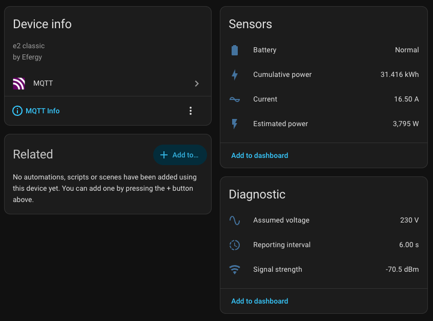
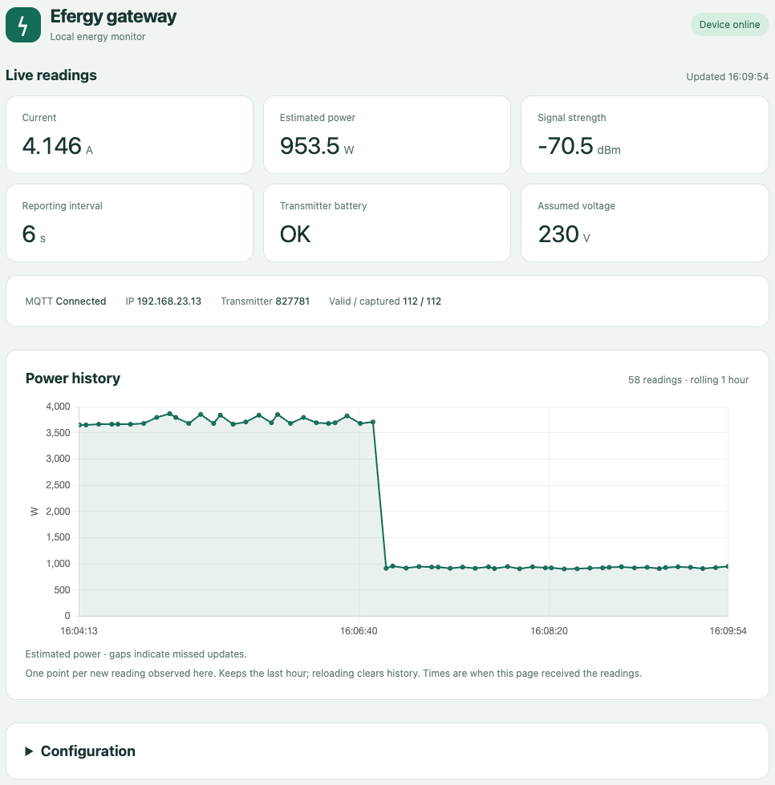
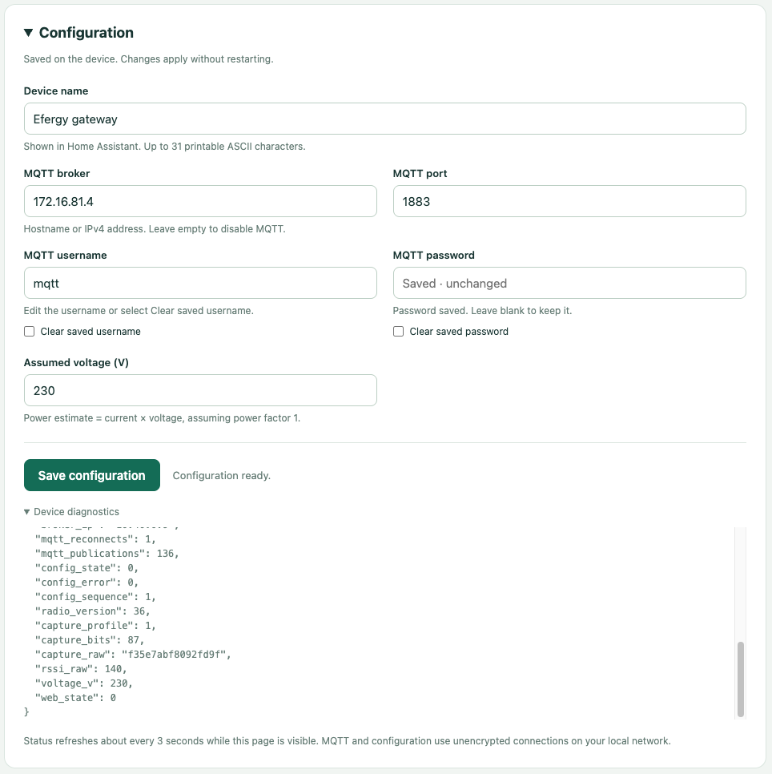

# Efergy Engage Hub firmware

## Efergy is dead. Long live Efergy!


I bought my Efergy transmitter and hub in 2024. In January 2026, Efergy shut down
its cloud service and officially decommissioned the product.

Efergy never released the OEM firmware source code. [Existing](https://github.com/aarond10/powermeter_hub_server) [community](https://github.com/DevOldSchool/powermeter_hub_server) [projects](https://github.com/ahentz72/efergy_rxfwd)
already provide local collection using SSLv3, DNS overrides and telemetry
parsers.

This is not that.

This project is a complete rewrite of the firmware. It provides:
- MQTT support with automatic Home Assistant registration
- A built-in HTTP server for monitoring and configuration
- OTA updates







If you're not ready to jump to custom firmware, there's also a patched version
of the OEM firmware which removes the SSLv3 layer and communicates over
plain HTTP on port 80.

No programmer? I've included a small Docker update server for loading firmware
images from OEM and the OTA functionality of the new firmware means you can
go back at any time.
Don't even need a screwdriver.

If you have a programmer, there are images for that too.

## Flashing paths

### OEM to custom firmware

Run the Docker update server on the gateway's LAN, set `images/firmware.hex` to
`firmware/custom/custom-0.6.3-from-oem.hex`, and point `*.sensornet.info` DNS at
the server:

```sh
cd oem-server
mkdir images logs
cp ../firmware/custom/custom-0.6.3-from-oem.hex images/firmware.hex
docker compose up --build -d

```

Allow several minutes with stable external power. See [full instructions](docs/public/switching.md#oem-371-to-custom).

### OEM to HTTP-only OEM

This uncomplicates the server config for local setups, no SSLv3 shenanigans needed.
The hub will still communicate with sensornet.info endpoints, but will do so over HTTP/80.

Use `firmware/oem/oem-3.7.1-http-update.hex` as `images/firmware.hex` and follow
the [patch instructions](docs/public/switching.md#oem-371-to-http-only-oem). It bypasses
the SSL client path and changes affected service requests to HTTP. The original
NTP address and OEM hostnames are preserved.

### Custom back to OEM (weird choice but okay)

From custom firmware, run:

```sh
python3 tools/restore_oem.py http://GATEWAY_IP \
  firmware/oem/oem-3.7.1-from-custom.zip --commit
```

The final conversion phase cannot safely tolerate power loss. See the
[OEM restoration guide](docs/public/switching.md#custom-to-oem-371).

For PICkit programming and recovery, use the full `*-pickit.hex` images and
follow the [hardware instructions](docs/public/hardware.md).

## Repository map

| Directory | Contents |
| --- | --- |
| `firmware/` | OEM and custom images. See its README for file selection. |
| `source/` | Custom firmware source, loader, converters and build files. |
| `tools/` | Host-side flashing and image tools. |
| `oem-server/` | Docker service for the OEM firmware update protocol. |
| `docs/` | Usage, build, hardware and validation notes. |

## Supported hardware

Tested with one Efergy Engage Hub, one transmitter and OEM firmware 3.7.1. Other
board revisions, transmitters and OEM versions are unverified. Keep external
power connected during conversions; do not use PICkit target power.


The hub contains a
- PIC18F67J60 with Ethernet MAC/PHY as the main controller
- RFM69W radio to receive sensor data
- SST25VF040B 4-Mbit SPI flash for cached readings when the cloud is unavailable (RIP)
- 24AA02E48 EEPROM holding the MAC address

The custom firmware re-purposes the SPI flash for configuration, web assets and update staging.

The PICkit-compatible header allows direct PIC programming. The OEM firmware
uses SSLv3 without certificate validation. The included patch bypasses its SSL
client path for the affected services.

## Licensing and release files

Project-authored code is GPL-3.0-only within the scope described in
[`LICENSE-SCOPE.md`](docs/public/LICENSE-SCOPE.md). Microchip source and OEM firmware retain
separate terms; see [`THIRD-PARTY-NOTICES.md`](docs/public/THIRD-PARTY-NOTICES.md) before
redistributing them.

`SHA256SUMS` covers the release files. No SPI or EEPROM dumps, device
credentials, private keys or private bench logs are included.
