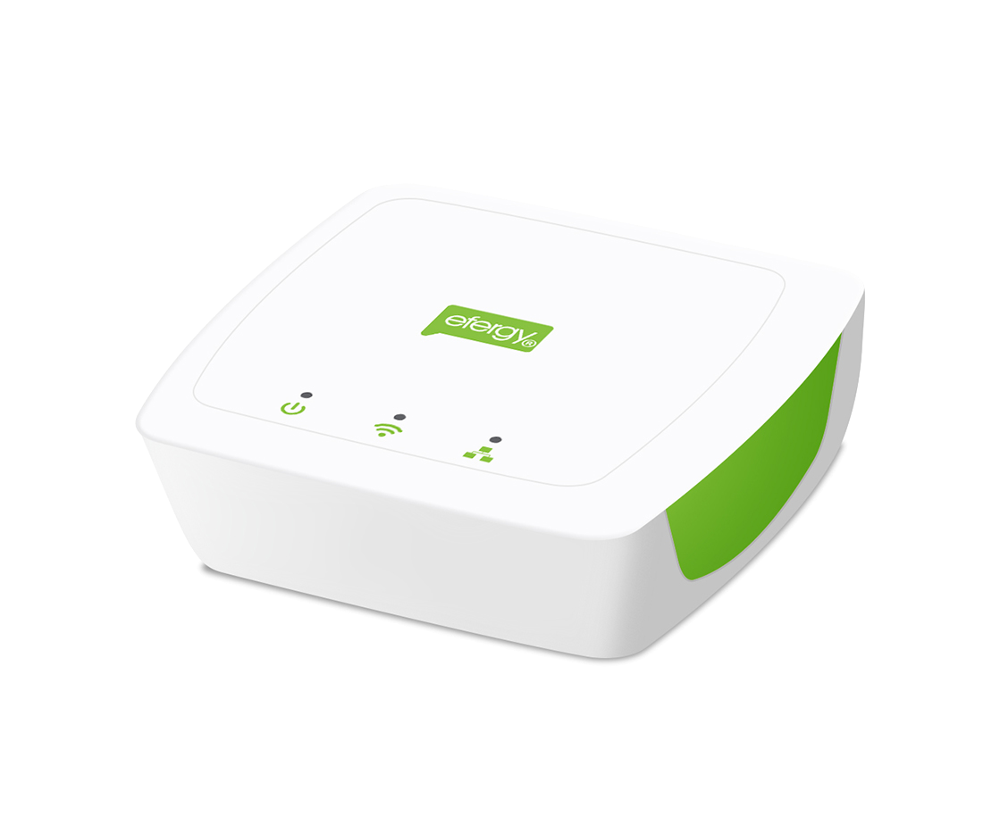
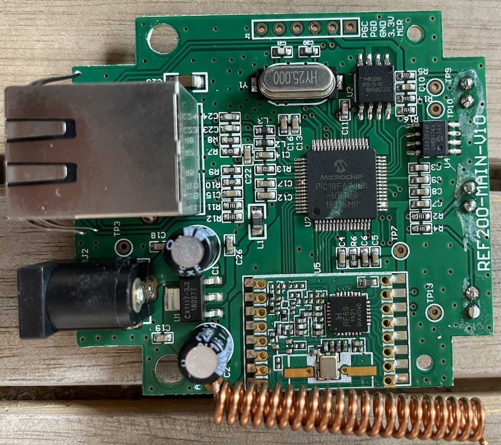

# Efergy Engage Hub firmware

## Efergy is dead. Long live Efergy!



I bought my Efergy transmitter and hub in 2024. In January 2026, Efergy shut down
its cloud service and officially decommissioned the product.

Efergy never released the OEM firmware source code. Existing community projects
already provide local collection using SSLv3, DNS overrides and telemetry
parsers. This project replaces the hub firmware and provides a small Docker
update server for loading firmware images through the OEM updater. It does not
receive telemetry.

## Flashing paths

### OEM to custom firmware

Run the Docker update server on the gateway's LAN, set `images/firmware.hex` to
`firmware/custom/custom-0.6.3-from-oem.hex`, and point `*.sensornet.info` DNS at
the server:

```sh
cd oem-server
mkdir -p images logs
cp ../firmware/custom/custom-0.6.3-from-oem.hex images/firmware.hex
docker compose up --build -d
```

Allow several minutes with stable external power. See [full instructions](docs/switching.md#oem-371-to-custom).

### OEM to HTTP-only OEM

Use `firmware/oem/oem-3.7.1-http-update.hex` as `images/firmware.hex` and follow
the [patch instructions](docs/switching.md#oem-371-to-http-only-oem). It bypasses
the SSL client path and changes affected service requests to HTTP. The original
NTP address and OEM hostnames are preserved.

### Custom back to OEM

From custom firmware, run:

```sh
python3 tools/restore_oem.py http://GATEWAY_IP \
  firmware/oem/oem-3.7.1-from-custom.zip --commit
```

The final conversion phase cannot safely tolerate power loss. See the
[OEM restoration guide](docs/switching.md#custom-to-oem-371).

For PICkit programming and recovery, use the full `*-pickit.hex` images and
follow the [hardware instructions](docs/hardware.md).

## Repository map

| Directory | Contents |
| --- | --- |
| `firmware/` | OEM and custom images. See its README for file selection. |
| `source/` | Custom firmware source, loader, converters and build files. |
| `tools/` | Host-side flashing and image tools. |
| `oem-server/` | Docker service for the OEM firmware update protocol. |
| `docs/` | Usage, build, hardware and validation notes. |

## Supported hardware

Tested with one Efergy Engage Hub, one transmitter and OEM firmware 3.7.1. Other
board revisions, transmitters and OEM versions are unverified. Keep external
power connected during conversions; do not use PICkit target power.



The hub contains a PIC18F67J60 with Ethernet MAC/PHY, an RFM69W radio, a
SST25VF040B 4-Mbit SPI flash and a 24AA02E48 EEPROM holding the MAC address. The
custom firmware uses SPI flash for configuration, web assets and update staging.
The OEM firmware also used it for cached readings.

The PICkit-compatible header allows direct PIC programming. The OEM firmware
uses SSLv3 without certificate validation. The included patch bypasses its SSL
client path for the affected services.

## Licensing and release files

Project-authored code is GPL-3.0-only within the scope described in
[`LICENSE-SCOPE.md`](LICENSE-SCOPE.md). Microchip source and OEM firmware retain
separate terms; see [`THIRD-PARTY-NOTICES.md`](THIRD-PARTY-NOTICES.md) before
redistributing them.

`SHA256SUMS` covers the release files. No SPI or EEPROM dumps, device
credentials, private keys or private bench logs are included.
